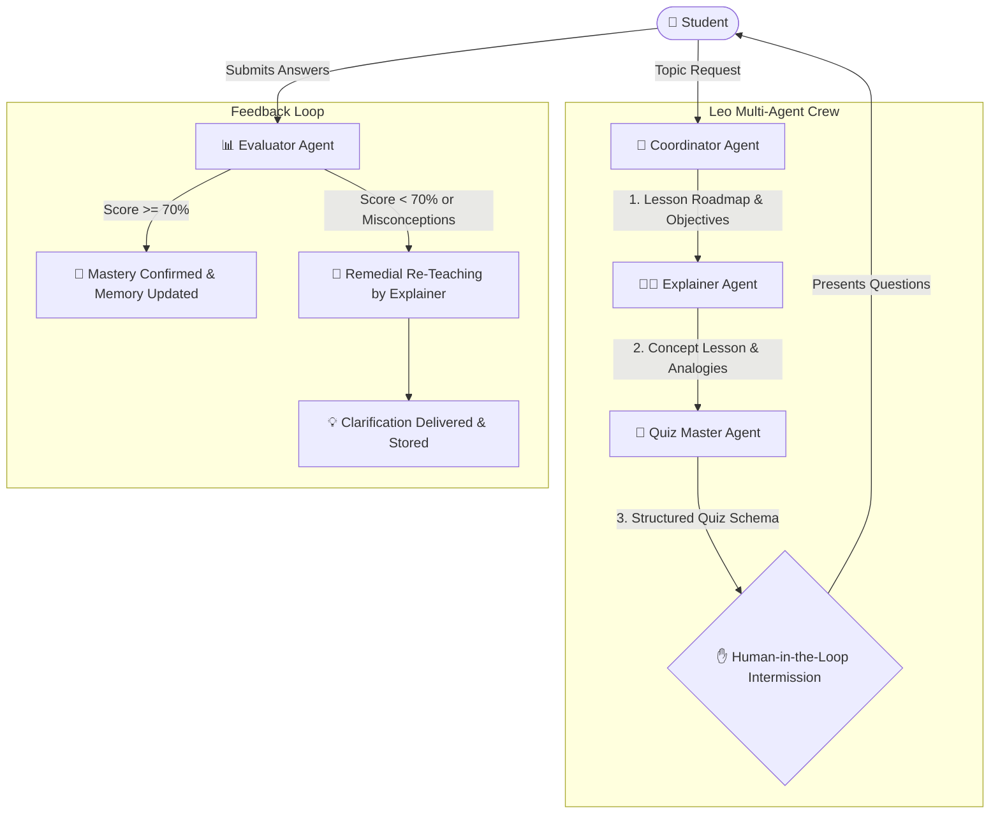

# Leo: Multi-Agent AI Tutor


**Leo** is an intelligent, multi-agent AI study companion built using **CrewAI**. Instead of acting as a single monolithic chatbot, Leo deploys **four specialized autonomous agents** that collaborate sequentially to guide students through a tailored learning journey: curriculum planning, intuitive concept teaching, structured assessment generation, and empathetic performance evaluation with an adaptive feedback loop.

---

## 📋 Table of Contents
- [System Architecture](#-system-architecture)
- [The 4 Core Agents & Roles](#-the-4-core-agents--roles)
- [Orchestration Pattern & Real Handoffs](#-orchestration-pattern--real-handoffs)
- [Module Alignment](#-module-alignment)
  - [Module 21: Memory & Prompt Templates](#module-21-memory--prompt-templates)
  - [Module 22: Academic Tools](#module-22-academic-tools)
  - [Module 23/26: Multi-Agent Coordination](#module-2326-multi-agent-coordination)
- [Bonus Features (+10 Marks)](#-bonus-features-10-marks)
  - [1. Human-in-the-Loop Intermission](#1-human-in-the-loop-intermission)
  - [2. Adaptive Feedback Loop (Re-teaching)](#2-adaptive-feedback-loop-re-teaching)
- [Installation & Setup](#-installation--setup)
- [How to Run](#-how-to-run)
- [Sample Run Walkthrough](#-sample-run-walkthrough)


---

## 🏗 System Architecture



### Text Flow Diagram
```text
[Student] ---> (Topic: Photosynthesis)
      │
      ▼
[1. Coordinator Agent] ──(Validates topic, creates 3-step roadmap)──► [2. Explainer Agent]
                                                                             │
                                                                             ▼ (Teaches concept)
[Student's Answers] ◄──(Human-in-the-Loop Intermission)──◄── [3. Quiz Master Agent] (Pydantic Quiz)
      │
      ▼
[4. Evaluator Agent] ──(Grades answers, computes score, analyzes misconceptions)
      │
      ├─── [Score >= 70%] ────► Session Logged in Student Memory ✅
      └─── [Score < 70%] ─────► [Adaptive Feedback Loop] ──► Explainer Re-teaches Weak Points 🔄
```

---

## 🤖 The 4 Core Agents & Roles

| Agent | Role Title | Primary Goal | Distinct Behavior & Backstory |
| :--- | :--- | :--- | :--- |
| **1. Coordinator** | Study Coordinator & Academic Planner | Analyzes student request, clarifies ambiguous topics, and structures a 3-step curriculum. | Academic planner who designs clear, manageable learning pathways, establishes goals, and checks student memory history. |
| **2. Explainer** | Subject Matter Explainer & Concept Teacher | Teaches core principles using crystal-clear intuitive analogies and real-world examples. | Master tutor skilled in transforming complex theories (physics, biology, computer science) into accessible mental models. |
| **3. Quiz Master** | Adaptive Assessment Designer | Formulates practice questions testing deep comprehension with structured schema. | Assessment specialist generating targeted multiple-choice and conceptual questions with full answer keys and rubrics. |
| **4. Evaluator** | Performance Evaluator & Academic Coach | Assesses student answers, scores performance (0-100%), and detects misconceptions. | Empathetic evaluator balancing objective grading with constructive encouragement and deciding whether remedial re-teaching is needed. |

---

## 🔄 Orchestration Pattern & Real Handoffs

Leo uses a **Sequential Orchestration Pattern with Explicit Context Passing** implemented via CrewAI:

1. **Handoff 1 (Coordinator ➔ Explainer)**:
   - `task_teach` takes `context=[task_plan]`. The Explainer does not teach in a vacuum; it directly ingests the specific roadmap, vocabulary, and goals defined by the Coordinator.
2. **Handoff 2 (Explainer ➔ Quiz Master)**:
   - `task_quiz` takes `context=[task_teach]`. The Quiz Master bases questions directly on what the Explainer taught, outputting structured data via a **Pydantic Model** (`Quiz`).
3. **Handoff 3 (Quiz Master ➔ Human-in-the-Loop Intermission)**:
   - Execution pauses so the student can read the Quiz Master's generated questions and type their responses.
4. **Handoff 4 (Quiz Master + Student Input ➔ Evaluator)**:
   - The Evaluator receives both the original quiz answer key and the student's live input, evaluating accuracy and computing a numerical score.
5. **Handoff 5 (Evaluator ➔ Explainer Feedback Loop)**:
   - If the student scores `< 70%` or shows conceptual confusion, the Evaluator passes the weak concepts back to the Explainer for immediate remedial re-teaching.

---

## 🧩 Module Alignment

### Module 21: Memory & Prompt Templates
- **Prompt Templates**: Each agent uses dedicated, parameterized prompt templates (`COORDINATOR_PROMPT_TEMPLATE`, `EXPLAINER_PROMPT_TEMPLATE`, `QUIZ_MASTER_PROMPT_TEMPLATE`, `EVALUATOR_PROMPT_TEMPLATE`, `RETEACH_PROMPT_TEMPLATE`) configured with `{student_name}`, `{topic}`, and `{learning_level}`.
- **Student Memory**: Persistent JSON-backed memory (`StudentMemory`) tracks:
  - Total completed sessions
  - History of topics studied
  - Historical quiz scores
  - Documented strengths and concepts needing future review
- **CrewAI Memory**: CrewAI built-in memory is active (`memory=True`) for contextual awareness across agent tasks.

### Module 22: Academic Tools
Leo equips agents with custom tools built using CrewAI's `@tool` decorator:
- `academic_concept_lookup`: Looks up verifiable academic definitions and core scientific principles.
- `academic_safe_calculator`: Evaluates mathematical expressions and formulas safely for STEM calculations.
- `academic_web_search`: Live Wikipedia and academic resource search via REST API for up-to-date facts and summaries.

### Module 23/26: Multi-Agent Coordination
- Built completely with **CrewAI** (`crewai>=1.15.0`).
- Clean separation of roles, tools, and execution tasks.
- Works with OpenRouter models (e.g. `deepseek/deepseek-chat`).

---

## 🌟 Bonus Features

### 1. Human-in-the-Loop Intermission
Unlike fully automated bots that simulate user answers, Leo pauses mid-session:
- The Quiz Master displays the custom-generated questions in the CLI.
- The student is prompted to type their answers in real-time.
- The student's actual responses are captured and passed directly to the Evaluator.

### 2. Adaptive Feedback Loop (Re-teaching)
If the Evaluator determines the student scored below passing grade (`< 70%`) or holds critical misconceptions:
- The Evaluator sets `needs_reteaching = True` and enumerates the specific `reteach_topics`.
- An automated feedback loop activates, routing these weak topics back to the **Explainer Agent**.
- The Explainer delivers a **targeted remedial micro-lesson** with new analogies and a key takeaway rule.

---

## 💻 Installation & Setup

### 1. Clone the Repository
```bash
https://github.com/Murad03255/Multi-Agent-AI-Tutor.git
cd Leo-Ai-Tutor
```

### 2. Set Up Virtual Environment (Recommended)
```bash
python -m venv .venv

# On Windows (PowerShell):
.\.venv\Scripts\Activate.ps1

# On Linux/macOS:
source .venv/bin/activate
```

### 3. Install Dependencies
```bash
pip install -r requirements.txt
```

### 4. Configure Environment Variables
Create a `.env` file in the root directory (refer to `.env.example`):
```env
OPENROUTER_API_KEY=sk-or-v1-your-openrouter-key-here
MODEL_NAME=openrouter/deepseek/deepseek-chat
```
> **Security Note**: Never commit your `.env` file containing secret API keys. The `.gitignore` file is pre-configured to keep your keys secure.

---

## 🚀 How to Run

Leo provides two interfaces: a **Rich Streamlit Web Dashboard** and an **Interactive Terminal CLI**.

### Option A: Streamlit Web Dashboard (Recommended)
Launch the modern, responsive web application:
```bash
streamlit run app.py
```
- Open `http://localhost:8501` in your browser.
- Select your learning level and view your real-time student profile and persistent memory stats.
- Enter any study topic or click one of the quick suggestions (`Photosynthesis`, `Binary Search`, `Gravity`).
- Watch the **Coordinator** organize the curriculum and the **Explainer** deliver the comprehensive lesson.
- Complete the practice questions in the **Human-in-the-Loop Intermission** form.
- Submit to the **Evaluator** to receive your percentage score, mastered concepts, and coaching feedback.
- If your score is `< 70%`, watch the **Adaptive Feedback Loop** activate with the Explainer providing targeted remedial instruction!

### Option B: Interactive Terminal CLI
Run directly in your command line:
```bash
python leo.py
```

#### Follow the On-Screen Prompts:
1. **Enter your name** (e.g., `Murad`).
2. **Enter the topic** you wish to learn (e.g., `Photosynthesis`, `Binary Search`, `Gravity`).
3. **Select difficulty level** (e.g., `Beginner`, `Intermediate`, `Advanced`).
4. Read the **Coordinator's Plan** and the **Explainer's Lesson**.
5. Answer the **Quiz Master's Questions** in the Human-in-the-Loop prompt.
6. Review your **Evaluation Report** and score.
7. If your score is low, watch the **Adaptive Feedback Loop** trigger a targeted remedial lesson!

---


## 📁 Project Structure

```text
Leo-Ai-Tutor/
├── .env.example          # Template for API key configuration
├── .gitignore            # Excludes .env, virtual environments, cache
├── app.py                # Streamlit Web Dashboard
├── leo.py                # Agent definitions, CrewAI orchestration & CLI runner
├── memory.py             # JSON-backed student profile & session memory
├── tools.py              # Custom tools: concept lookup, calculator, Wikipedia search
├── requirements.txt      # Project dependencies (CrewAI, Streamlit, etc.)
├── student_memory.json   # Auto-generated persistent learning store (gitignored)
└── README.md             # Project documentation
```

---

## 👨‍💻 Author
- **Murad** — Module 26 Assignment: Multi-Agent Systems
- Reference: [Module 23 Multi-Tool AI Agent](https://github.com/Murad03255/Building-a-Multi-Tool-AI-Agent-to-Interact-with-Medical-Datasets-and-Web)